<div align="center">



<a href="https://gabrielgandra.vercel.app">
  
</a>

<br/>

<a href="https://gabrielgandra.vercel.app"></a>
<a href="mailto:contatogabrielgandra@gmail.com"></a>
<a href="https://wa.me/5531997642122"></a>
<a href="https://gabrielgandra.vercel.app/assets/Curriculo_Gabriel_Gandra.pdf"></a>


</div>

<br/>

## 👋 Sobre mim

Sou o **Gabriel**, tenho **22 anos**, moro em **Belo Horizonte** e trabalho como **Analista de Infraestrutura de TI Jr. na JDC Consultoria em Informática**, alocado na **Prosegur**, onde estou há mais de 3 anos. Comecei como assistente de suporte em 2023 e cresci até a infraestrutura.

No dia a dia, administro **identidades e dispositivos** com Active Directory, Azure e Microsoft Intune, cuido do ciclo de vida dos equipamentos e atendo usuários em **português e espanhol**, incluindo as áreas da Prosegur na Espanha. Fora do suporte, escrevo **automações**, empacoto aplicativos em **.bat / .msi** e desenvolvo **sites, sistemas e jogos**.

```yaml
agora:      Analista de Infraestrutura Jr. · JDC Consultoria (Prosegur)
estudando:  Bacharelado em Ciência da Computação · UniBH (2025 – 2027/28)
foco:       infraestrutura, redes, cloud e desenvolvimento
idiomas:    Português (nativo) · Espanhol (intermediário-avançado) · Inglês (intermediário)
```

<div align="center">
  
</div>

<br/>

## 🧭 Trajetória

<div align="center">
  
</div>

<details>
<summary><b>Ver o que faço no cargo atual</b></summary>
<br/>

**Analista de Infraestrutura Jr.** · JDC Consultoria em Informática · alocado na Prosegur · *06/2025 – atual*

- Administro contas, grupos, dispositivos e políticas com **Active Directory, Azure e Microsoft Intune**, incluindo licenças, pastas compartilhadas e acesso ao Wi‑Fi corporativo.
- Crio **scripts de automação** e empacoto a instalação de aplicativos complexos em **.bat e .msi**; também desenvolvo sites e aplicativos internos que reduzem tarefas manuais e o tempo de atendimento.
- Presto **suporte técnico em espanhol** para áreas da Prosegur na Espanha.
- Conduzo projetos de **renovação do parque**: atualização de máquinas, desativação de equipamentos, formatação e migração de dados.
- Gerencio o **ciclo de vida dos ativos** e escrevo **manuais operacionais** para a equipe.
- Atendo usuários via Teams, telefone, presencialmente e pelo **BMC Helix ITSM**; instalo softwares e impressoras Zebra, Lexmark e matriciais.

</details>

<br/>

## 🛠️ Stack e ferramentas

<div align="center">

**Infraestrutura, identidade e ITSM**


<br/><br/>

**Desenvolvimento**

<a href="https://skillicons.dev">
  
</a>

</div>

<br/>

## 🚀 Projetos

Fora do suporte, crio sites, produtos e jogos. Alguns sites foram vendidos para clientes; outros são projetos meus. Todos estão no ar 👇

<table>
<tr>
<td width="33%" valign="top">

### 💈 BarbersApp
**Produto próprio · SaaS**<br/>
Sistema para barbearias: agendamento, programa de fidelidade, cupons, mapa interativo e landing page.

<a href="https://www.barbersapp.com.br/"></a>

</td>
<td width="33%" valign="top">

### 🍽️ MesaRápida
**Produto próprio · Reservas**<br/>
Reserva de mesas em segundos para restaurantes, com organização das mesas e menos faltas (no‑show).

<a href="https://www.mesarapida.com.br/"></a>

</td>
<td width="33%" valign="top">

### 💍 Diário de Noivos
**Produto próprio · Casamentos**<br/>
Organização do casamento a dois: convidados, orçamento, fornecedores e site com lista de presentes e RSVP.

<a href="https://diariodenoivos.com.br/"></a>

</td>
</tr>
<tr>
<td width="33%" valign="top">

### 🎤 Aldrin Gandra
**Cliente · Site oficial**<br/>
Site oficial de cantor e compositor de BH, com músicas, clipes e contratação de shows.

<a href="https://www.aldringandra.com.br/"></a>

</td>
<td width="33%" valign="top">

### 🎙️ GandraCast
**Podcast**<br/>
Site do podcast com os episódios do YouTube, cortes para redes sociais e página de parcerias para marcas.

<a href="http://gandracast.com.br/"></a>

</td>
<td width="33%" valign="top">

### 🎓 Go After
**Cliente · Educação**<br/>
Plataforma completa de aprendizagem on‑line para uma escola.

<a href="http://goafter.com.br/"></a>

</td>
</tr>
</table>

<details>
<summary><b>🎮 Jogos no Roblox (hobby)</b></summary>
<br/>

| Jogo | Gênero | |
|---|---|---|
| **Caos Burger** | Terror · de dia um hipermercado na neblina, à noite o drive‑thru | [Jogar](https://www.roblox.com/pt/games/82373635262098/Caos-Burger) |
| **Hungry Lake** | Pesca e terror · 1 a 6 jogadores | [Jogar](https://www.roblox.com/pt/games/73925819065394/Hungry-Lake-Horror-Fishing) |
| **Echoes of the Deep** | Sobrevivência · esquadrão de 1 a 4 em minas abandonadas | [Jogar](https://www.roblox.com/pt/games/73423319870769/Echoes-of-the-Deep-Abyss-Chronicles) |

</details>

<br/>

## 🎓 Formação

| | Curso | Instituição | Período |
|---|---|---|---|
| 🎓 | Bacharelado em Ciência da Computação | UniBH | 2025 – prev. 2027/28 |
| 📱 | Técnico em Informática · Desenvolvimento Mobile | Cotemig | 2021 – 2022 |
| 🤝 | Voluntário no Code Club (ensino de programação) | Cotemig | 2022 |
| 🇪🇸 | Certificado de Espanhol | Colégio Espanhol Santa Maria Minas | 2020 |

<br/>

## 📈 Atividade

<div align="center">
<picture>
  <source media="(prefers-color-scheme: dark)" srcset="https://raw.githubusercontent.com/Gabriel-Gandra/Gabriel-Gandra/output/github-snake-dark.svg"/>
  <source media="(prefers-color-scheme: light)" srcset="https://raw.githubusercontent.com/Gabriel-Gandra/Gabriel-Gandra/output/github-snake.svg"/>
  
</picture>
</div>

<br/>

<div align="center">

**Tem uma vaga ou um projeto?** Vamos conversar.

<a href="mailto:contatogabrielgandra@gmail.com"></a>
<a href="https://gabrielgandra.vercel.app"></a>


</div>
